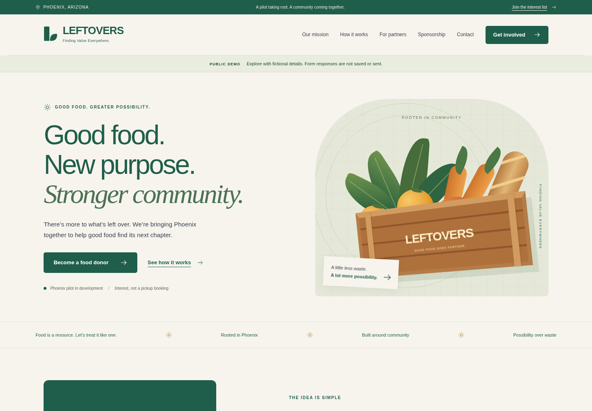
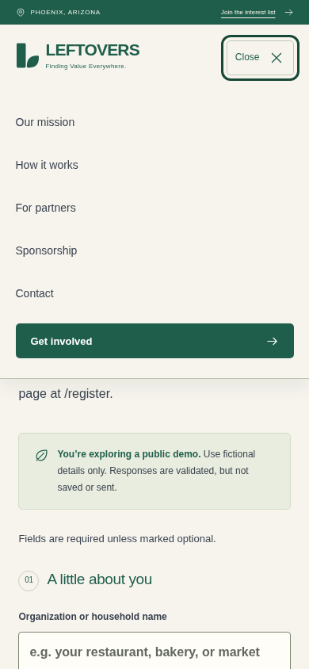
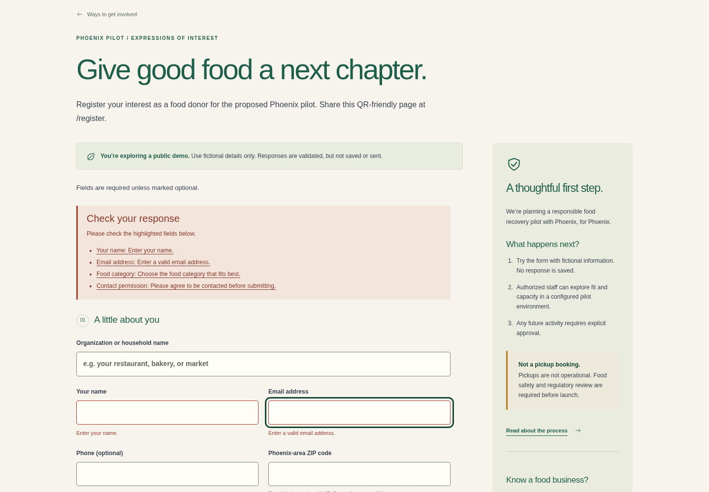
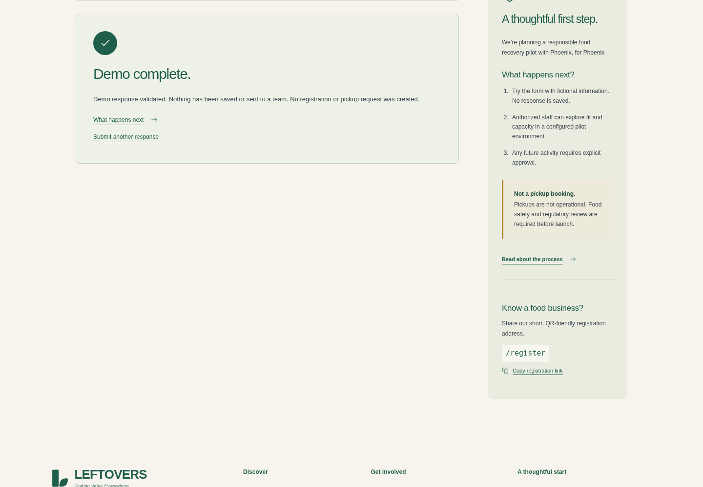
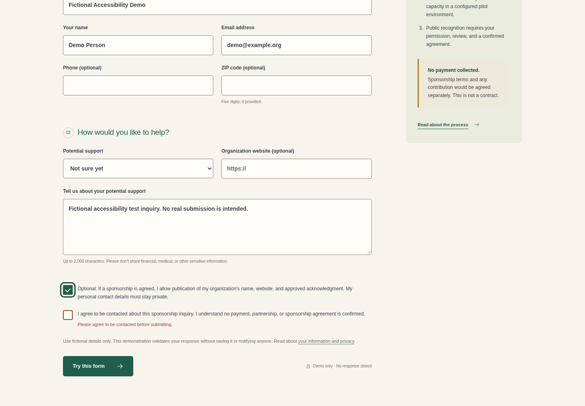
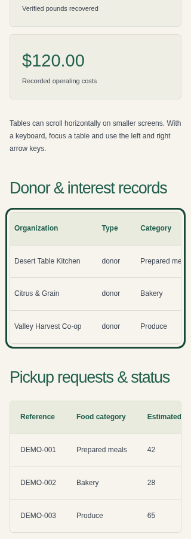
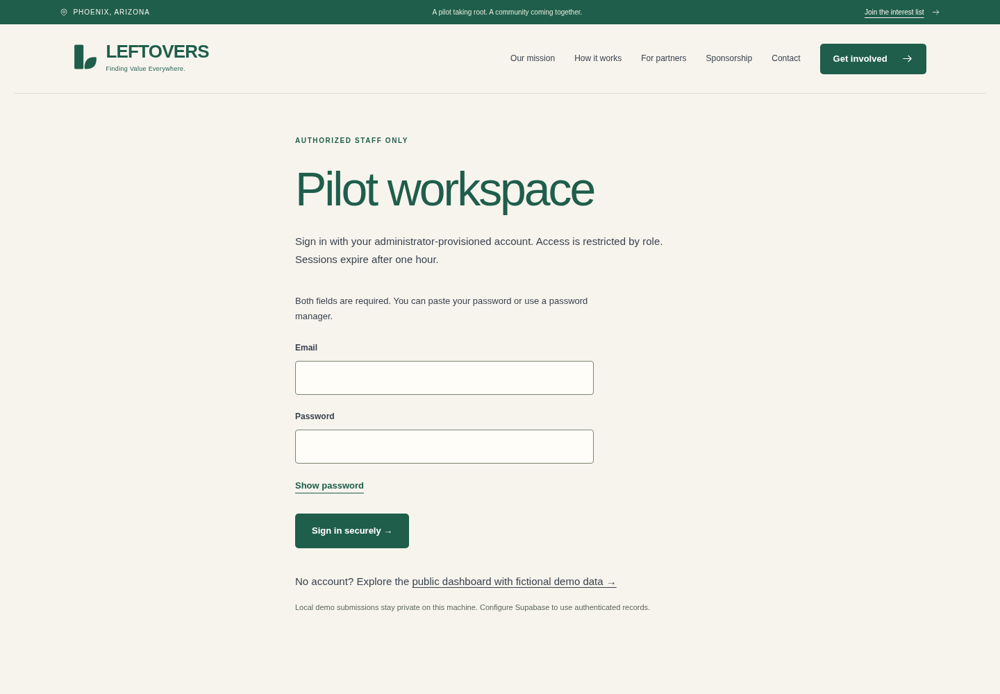
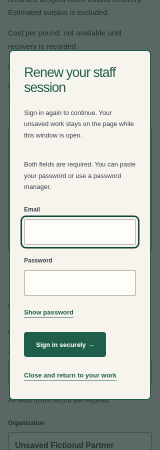

# LEFTOVERS accessibility review

Reviewed November 14, 2026. Target: **WCAG 2.2 Level AA**. This is an engineering review and remediation record, not a full conformance certification.

## Scope and evidence

The public Netlify hostname could not be loaded from this workspace: the environment gateway rejected its connection with HTTP 403 before reaching the site. This review therefore uses the repository's production build locally. The baseline matches commit `7fabd8b`. All screenshots are from this review run, with fictional details only.

The baseline included 13 public routes at desktop and 320 CSS pixels (26 scans), a donor error/success flow, sponsorship consent, and a demo dashboard. It found four axe rule categories: low FAQ-number contrast, visible-label/accessibility-name mismatch on brand links, content outside landmarks, and dashboard scroll regions without keyboard focus.

The remediation suite covers 15 public routes at 1440 and 320 CSS pixels, five form error/success flows, keyboard navigation, 200% text-size simulation with WCAG text-spacing overrides, forced colors, reduced motion, and staff roles. Staff UI tests use a local fake Supabase service; they exercise the real application screens without connecting to a live database. PostgreSQL RLS tests remain separate.

Validation completed: **68 application/database tests passed; 16 browser tests passed with zero reported axe violations in the covered states.** The four affected staff tests were rerun successfully after the final session-announcement and credential-clearing adjustments. Build and TypeScript checks passed. No tests were skipped.

## Flow findings and fixes

| Step | Flow | Result of remediation |
| --- | --- | --- |
| 1 | Homepage and shared navigation | Brand links derive their names from visible text. Pilot and demo notices are within the header landmark. FAQ numbers have stronger contrast. Main-content targets accept skip-link focus. |
| 2 | Mobile navigation | Menu supports Tab, Enter and Escape. Leaving the menu closes it before the next page control receives focus, keeping that control visible. |
| 3 | Donor form errors | Required-field instructions, focused error summary, links to affected fields, field error associations, and stronger input boundaries. |
| 4 | Donor, survey, pickup, contact and sponsor confirmation | Each demo flow validates without storing data, focuses its named confirmation, and announces the outcome. Failed requests retain entered values. |
| 5 | Sponsorship consent | Public-recognition permission remains optional and separate from required contact permission. Checkboxes have 24px controls and keyboard support. No payment or public recognition is created by a demo trial. |
| 6 | Dashboard tables | Table captions, column/row headers, named focusable scroll regions, and arrow-key horizontal scrolling. Tables can overflow inside their regions without creating page-wide overflow. |
| 7 | Staff sign-in and role screens | Password-manager and paste support, password visibility control, focused errors, and controls kept inside the main landmark. Admin, coordinator and analyst screens use fictional test records. |
| 8 | Session renewal and staff editing | Two-minute expiry warning, native modal dialog, Escape and focus restoration, authenticated renewal without clearing unsaved fields, and focused failure feedback for planning and sponsor forms. |

## Captured flow

All eight steps below passed their local checks. Screenshots were opened and inspected before inclusion; they show fictional data only. Visual evidence supports the layout and focus findings. The browser assertions provide the keyboard, state, name, and contrast evidence that screenshots alone cannot establish.

1. **Homepage — passed:** shared landmarks, visible brand name, and primary actions.



2. **Mobile navigation — passed:** visible focus on the menu control; Escape and leaving the menu were tested.



3. **Form errors — passed:** linked summary, described field error, and high-contrast email focus.



4. **Confirmation — passed:** named confirmation region receives focus; the demo explicitly confirms no data was stored.



5. **Sponsor consent — passed:** optional recognition and required contact permission remain distinct; keyboard-toggled recognition is shown.



6. **Tables — passed:** named, focusable scroll region at 320px with keyboard instructions. Horizontal scrolling stays within the table.



7. **Staff sign-in — passed:** required labels, password-manager instructions, and visibility control. Failure feedback and three role screens were tested separately.



8. **Session renewal — passed:** native modal at 320px, focused email field, and unsaved fictional work retained behind the dialog. Successful renewal restores focus and clears the closed sign-in form.



## WCAG-related implementation

- **1.1.1 / 1.3.1:** Image alternatives, decorative icons hidden from assistive technology, headings and landmarks, named forms, and table relationships.
- **1.4.3:** FAQ-number contrast corrected. Text contrast is included in axe scans. Supplied logotype artwork is preserved; meaningful alternatives remain available.
- **1.4.11 / 2.4.7:** Input-border contrast increased from 1.85:1 to 3.77:1 against its background. Keyboard focus uses a dark outline and light ring so it remains distinguishable on cream and forest surfaces. Forced-colors mode retains a native checkbox and system focus outline.
- **1.4.4 / 1.4.10 / 1.4.12:** Responsive reflow at 320 CSS pixels and 200% text-size simulation with 1.5 line height, .12em letter spacing, .16em word spacing, and 2em paragraph spacing. Header and metric layouts can wrap. Tables retain their permitted two-dimensional scroll regions.
- **2.1.1 / 2.1.2 / 2.4.1 / 2.4.3 / 2.4.11:** Keyboard-operable navigation, FAQ, forms, tables and dialogs; functional skip links; menu dismissal; and explicit error/confirmation focus handling.
- **2.2.1:** Staff can renew a one-hour session, with a warning near expiry and no fixed renewal count. The page retains unsaved fields during reauthentication, including after expiry. The public form's anti-spam age limit is 24 hours, exceeding the criterion's 20-hour exception; failed attempts retain fields.
- **2.5.3 / 2.5.8:** Visible brand text participates in link names. Standalone footer links have at least 24px height, form checkboxes are 24px, and primary controls provide larger targets. Target-size coverage is included where supported by axe; this does not replace a manual review of all exceptions.
- **3.3.1 / 3.3.2 / 3.3.3 / 3.3.8:** Labels, required/optional instructions, linked error feedback, password-manager and paste support, and visibility control. No memory puzzle is introduced for staff sign-in.
- **4.1.2 / 4.1.3:** Native HTML controls, accessible names, expanded/pressed/busy states, live feedback, and named confirmation regions.

## Repeatable checks

```sh
npm ci
# Only when no compatible system browser is installed:
npx playwright install chromium
npm test
npm run typecheck
npm run test:a11y
```

`test:a11y` first builds in preview mode, then starts the preview site, staff site, and local fictional backend on ports 3150–3152. It uses axe WCAG 2 A/AA, WCAG 2.1 A/AA, WCAG 2.2 AA and best-practice tags. Browser results and screenshots are in ignored `test-results/`. No paid tools or external accessibility overlay are needed.

## Verification still required before a conformance claim

- Recheck the deployed HTTPS site after Netlify builds this revision; the workspace network block prevents live verification here.
- Complete human screen-reader review with NVDA/Firefox or Chrome, VoiceOver/Safari on macOS/iOS, and TalkBack/Chrome on Android. Automated names and relationships do not establish the quality of spoken output.
- Check real browser 200%/400% zoom and device orientation. The automated 200% text-size simulation and 320px reflow test are useful evidence but are not every browser/device combination.
- Exercise the real Turnstile widget, its error/expiry states, live staff accounts and session renewal, connection loss, and real Supabase permissions. Test fixtures do not establish deployed provider behavior.
- Review target-size exceptions, long content, keyboard focus at the end of unusually long pages, and future content or third-party changes.
- In public demo mode the contact form cannot deliver accessibility reports; the statement explicitly directs people to the project contact who shared the demo. Establish a functioning reporting channel when real intake opens.

Food pickups remain non-operational. Accessibility changes do not establish operational approval, free service, tax benefits, or guaranteed pickup availability.
